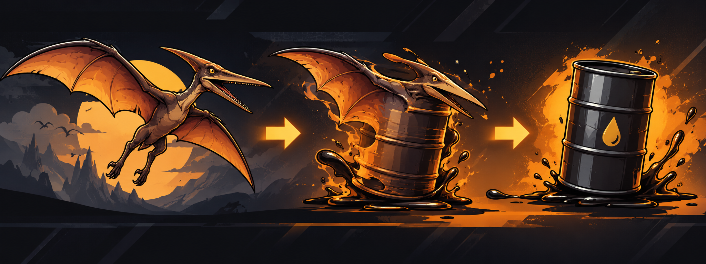

# Erdoel (Oil) - Cloud Computing Group 5

**Members:** Julian Wieser, Jakob Guggenbichler, Jakob Defranceschi, Dominik Mayerl

## Overview

We base our project on the [Pterodactyl Panel](https://github.com/pterodactyl/panel) and
[Pterodactyl Wings](https://github.com/pterodactyl/wings) (stable 1.x release, pinned versions).

Pterodactyl is an open-source game server management platform. The **Panel** (PHP/Laravel + React) is the web UI and
API, **Wings** (Go) is the daemon on each node that starts every game server as its own Docker container.
Setting it up by hand takes many manual steps (database, Redis, web server, TLS, migrations, node registration), and
out of the box it gives the host almost no insight into resource usage or security of the running game servers.

## Goal:
Deploy Pterodactyl to the cloud reproducibly from a single Git repository, and make the system observable and secure:
metrics and alerts for the hosts and for every game server, plus runtime threat detection.

## Scope

1. **Infrastructure as Code:** everything is defined in [OpenTofu](https://github.com/opentofu/opentofu):
    - **Hosts:** OpenTofu provisions the cloud VMs on Hetzner (one Panel VM, one Wings VM,
      network, firewall) and installs Docker via cloud-init.
    - **Services:** Panel, MariaDB, Redis, Prometheus, Grafana and Falco run as containers, deployed through the
      OpenTofu Docker provider over SSH. Wings is installed as a systemd service via cloud-init, as recommended by the
      Pterodactyl docs.
    - **Bootstrap:** database migrations and the initial admin user are created automatically on first deployment.
    - **State:** remote OpenTofu state in the provider's object storage (bucket created once, documented in the README).
2. **CI/CD:** [GitHub Actions](https://docs.github.com/actions):
    - **Pull request:** `tofu fmt -check`, `tofu validate`, `tofu plan` (posted as PR comment), Prometheus rule check
      (`promtool check rules`) and Falco rule validation.
    - **Merge to `main`:** `tofu apply` after manual approval (GitHub Environment protection rule).
3. **Observability:** [Prometheus](https://github.com/prometheus/prometheus) and
   [Grafana](https://github.com/grafana/grafana) with node_exporter (hosts) and cAdvisor (game server containers):
   an overview dashboard, a per-game-server dashboard and alert rules (CPU, memory, disk, server down).
4. **Security:** [Falco](https://github.com/falcosecurity/falco) (modern eBPF driver) with custom rules, e.g. shell
   spawned in a game server container, unexpected outbound connections, writes to sensitive paths. Alerts are
   forwarded via Falcosidekick and shown in Grafana.

## Out-of-Scope

- Changing Pterodactyl itself: we use it as it is and only extend it around the outside.
- Running Wings inside Kubernetes: Wings manages containers through the Docker daemon directly, so we deploy it on
  VMs with Docker.
- Multiple environments (dev/staging/prod): we deploy a single cloud environment; changes are validated by CI before
  they are applied.

## Demo (planned)

1. Run the pipeline on a fresh cloud project -> working Panel + Wings node, create a Minecraft server from the Panel.
2. Grafana: overview dashboard and the per-server dashboard of the running game server.
3. Simulate load / memory exhaustion in a game server -> Prometheus alert fires.
4. `docker exec` a shell into a game server container -> Falco alert shows up in Grafana.
5. Open a pull request with a broken alert rule -> CI fails; fix it -> merge, approve -> change is applied.

## Milestones

| #  | Due        | Milestone                                                                                          |
|----|------------|----------------------------------------------------------------------------------------------------|
| M0 | 02.12.2026 | Proposal done, public GitHub repo, URL sent to all lecturers                                       |
| M1 | 09.12.2026 | OpenTofu provisions the cloud VMs and deploys Panel + one Wings node; a game server runs           |
| M2 | 16.12.2026 | GitHub Actions CI (validate/plan) + CD (apply with approval); Prometheus and Grafana running       |
| M3 | 23.12.2026 | Per-game-server dashboards, alert rules, Falco with custom rules and alert forwarding              |
| M4 | 06.01.2027 | Final submission: README with tutorial, demo rehearsed                                             |
| M5 | 13.01.2027 | Final presentation                                                                                 |

## Responsibilities

| Member              | Main responsibility                                                          | Milestones |
|---------------------|------------------------------------------------------------------------------|------------|
| Dominik Mayerl      | Infrastructure as Code (OpenTofu, cloud-init), Pterodactyl deployment        | M1         |
| Julian Wieser       | CI/CD pipelines (GitHub Actions, remote state, secrets, approval, validation) | M1, M2     |
| Jakob Defranceschi  | Observability (Prometheus, Grafana, exporters, alert rules)                  | M2, M3     |
| Jakob Guggenbichler | Security (Falco, custom rules, Falcosidekick alerting)                       | M3         |
| All                 | README documentation, lessons learned, presentation and demo                 | M4, M5     |